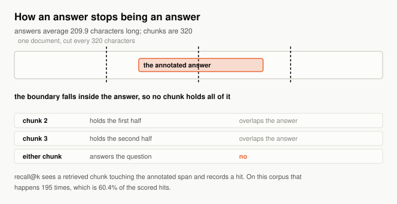
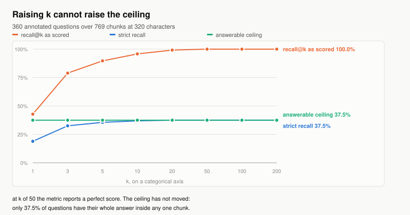
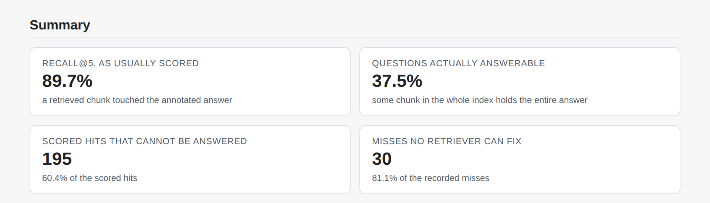
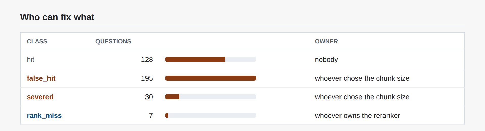
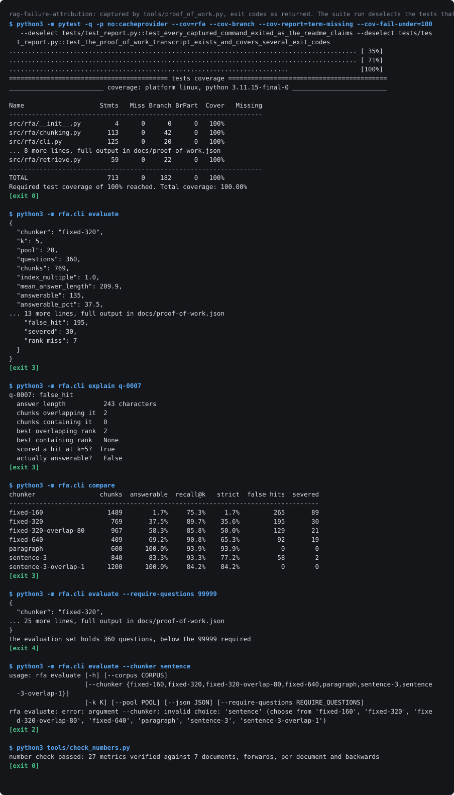

# rag-failure-attribution

[](https://github.com/Sruthi0510-data/rag-failure-attribution/actions/workflows/ci.yml)
[](https://www.python.org/)
[](#quickstart)
[](LICENSE)

**Attributes RAG retrieval failures to what actually caused them, separating the ones a better retriever can fix from the ones only re-chunking can, and finds the questions your recall metric is scoring as wins while the answer is not recoverable at all.**

## The question recall@k cannot answer

Ground truth is a character range in a document. Somebody read the document and highlighted the sentence that answers the question, months before anyone chose a chunk size. Retrieval returns chunks. The map between the two is many-to-many and lossy in the direction the metric reads it, so a chunk that holds half an answer is still the right chunk id.

Four questions this answers that recall@k structurally cannot:

1. When a question misses, was it the retriever, the chunker, the model, or ingestion. Those have four different owners and the metric hands all four to the retrieval team.
2. Which scored hits are not answerable at all, because a retrieved chunk touched the annotated span and no chunk anywhere in the index contains the whole of it.
3. What the ceiling is. Not the recall you got, the recall that was available before retrieval ran.
4. What a chunking change would cost, priced in index size and in the ranking failures overlap creates.

## The uncomfortable numbers

On the committed corpus of 120 policy documents and 360 annotated questions, chunked at a default of 320 characters into 769 chunks at a **strict recall of 35.6%** and k of five:

- Overlap-based recall@5 **reports 89.7%**. **only 37.5% of** the questions have their whole answer inside any one chunk. Both numbers describe the same run.
- Of the questions the metric scores as hits, **195 of them cannot** be answered from the index. That is **60.4% of the scored hits**.
- Of the **37 recorded misses**, **30 of those misses** are severance rather than retrieval, which is **81.1% of the misses**. There are **7 questions a retriever** change could address, against **225 need a chunking** change.
- Raising k does not help. At **k of 50 the metric** reports a perfect score, with the ceiling exactly where it started.

260 tests, 100.0% line and 100.0% branch coverage, and every figure on this page is re-measured by CI and matched against the wording around it by `tools/check_numbers.py`.

## Quickstart

Requires Python 3.11 or newer and nothing else. No API key, no model download, no network at runtime.

```bash
git clone https://github.com/Sruthi0510-data/rag-failure-attribution.git
cd rag-failure-attribution
pip install -e ".[dev]"

# the headline number
rfa evaluate --corpus fixtures/policy_corpus.json --chunker fixed-320

# raise k and watch the gap
rfa sweep

# why one question was classified the way it was
rfa explain q-0000

# re-measure everything on this page and fail if a sentence has gone stale
make verify
```



## Raising k cannot raise the ceiling



This is the impossibility in its most direct form. Overlap-based recall@k rises with k because a wider net eventually catches a chunk touching the annotated span. Answerability does not move, because it is a property of where the boundaries fell rather than of how many chunks you look at.

<!-- table:sweep generated by tools/render_tables.py from exp02_k_sweep.json -->
| k | recall@k as scored | strict recall | answerable |
| --- | --- | --- | --- |
| 1 | 42.8% | 18.9% | 37.5% |
| 5 | 89.7% | 35.6% | 37.5% |
| 20 | 99.2% | 37.5% | 37.5% |
| 50 | 100.0% | 37.5% | 37.5% |
<!-- /table:sweep -->

Every point of recall gained past the point where strict recall flattens is a false hit. A team optimising the first column can reach a perfect score without making one additional question answerable, and nothing in the metric says so.

## The four failures have four owners

| class | what it means | who can fix it |
| --- | --- | --- |
| `false_hit` | scored a win, no chunk holds the whole answer | whoever chose the chunk size |
| `severed` | no chunk holds the whole answer, and the score agreed it was a miss | whoever chose the chunk size |
| `rank_miss` | a containing chunk exists and ranked below k, inside the wider pool | whoever owns the reranker |
| `embedding_miss` | a containing chunk exists and never reached the pool at all | whoever owns the model |
| `absent` | no chunk covers the annotated characters at all | whoever owns ingestion |

The rank and embedding split is why the candidate pool runs four times wider than k. Without it every failure below k looks the same, and "add a reranker" and "change the model" become indistinguishable proposals. ADR-003 has the reasoning.

## Severance is arithmetic, not a mystery

A chunk covers `[k*stride, k*stride + size)`. An answer of length L starting at p is contained when `k*stride <= p` and `p + L <= k*stride + size`, so the chunk starts that work form an interval `size - L` wide. For uniform placement the containment probability is `min(1, (size - L + 1) / stride)`.

Two consequences fall straight out. With no overlap the severance rate is `(L - 1) / size`, so halving the chunk size doubles it. And severance reaches zero exactly when the overlap reaches `L - 1`, which is a fact about the longest answer in your evaluation set rather than about your retriever.

The model is checked twice. Against uniformly placed spans, which is its own assumption, over 4,000 placements, it lands **within 1.5 points**. Against the shipped corpus, where answers sit at sentence boundaries inside paragraphs of similar length, it is **out by 12.0 points** on the overlapping chunker.

That second residual is a finding, not an error. It says span placement in this corpus correlates with the chunk grid, so an overlap tuned by the formula alone does better than the formula predicts. A model that matched perfectly on real text would be the suspicious result.

## What a chunker choice actually costs

<!-- table:chunkers generated by tools/render_tables.py from exp03_chunker_tradeoff.json -->
| chunker | chunks | index | answerable | strict recall | rank and embedding misses |
| --- | --- | --- | --- | --- | --- |
| `fixed-160` | 1489 | 1.0x | 1.7% | 1.7% | 0 |
| `fixed-320` | 769 | 1.0x | 37.5% | 35.6% | 7 |
| `fixed-320-overlap-80` | 967 | 1.3x | 58.3% | 50.0% | 30 |
| `fixed-640` | 409 | 1.0x | 69.2% | 65.3% | 14 |
| `paragraph` | 600 | 1.0x | 100.0% | 93.9% | 22 |
| `sentence-3` | 840 | 1.0x | 83.3% | 77.2% | 22 |
| `sentence-3-overlap-1` | 1200 | 1.44x | 100.0% | 84.2% | 57 |
<!-- /table:chunkers -->

The small-chunk row is the one to read twice. A configuration that a retrieval dashboard would show as healthy **answers just 1.7%** of the questions asked of it. On this corpus the **best strict recall 93.9%** belongs to the paragraph chunker, which is also the one nobody reaches for because it looks unsophisticated.

### What overlap buys, against what it costs

Overlap is the standard advice once severance is understood, and the advice is right. What it leaves out is that overlap does not remove a failure, it converts one. Moving from `fixed-320` to `fixed-320-overlap-80` **recovers 75 answers**, **creates 23 new rank** misses, and **costs 1.3 times** the index.

That is progress, because a rank miss is fixable by a reranker and a severed answer is fixable by nothing. It is not the free win the advice implies, and it changes what the team should buy next.

## The bugs the measurement found

**A corpus that flattered one chunker by construction.** The first version planted every fact as a single sentence, so a sentence-aligned chunker could not sever one and scored a perfect hundred. That is a finding about the corpus, not about sentence chunking: the annotation unit happened to match the chunker's unit. A share of answers now spans two sentences, which is what a real annotation looks like when the answer is a rule plus its exception, and `sentence-3` now has to earn its result. A test fails if the shipped corpus loses that property.

**A suite that timed out because ranking was a scan.** The first index scored the query against every chunk. Correct, and quadratic in the shape this repository actually runs: several hundred questions against several hundred chunks, once per chunker and once per point on a k sweep. The suite stopped finishing. The index now holds a posting list per term and touches only the chunks sharing a term with the query, and `rank_exhaustively` is kept so a test can hold the fast path to the slow one, tie ordering included.

**A chunker that cut a word in half in its own test fixture.** Writing a test that the right chunk ranks first, the assertion failed: the 40-character boundary landed inside the word "replication", so the chunk that should have been the obvious match did not contain the term at all. The same mechanism that severs an answer severs the token that would have retrieved it, which is exactly why a low recall number and a chunking problem look identical from outside. That is a test now.

## Evidence

The report below is the tool's own HTML output. `tools/capture_screenshots.py` builds it if missing, frames each shot by scrolling to a named heading and clipping to the next, and reads the computed style of the verdict badge back out of the rendered page so an illegible headline fails the run.





Regenerate with `make report && make screenshots`.

## The corpus

Generated by a seeded generator, committed, and regenerable byte for byte with `rfa generate`. It holds 120 policy documents and 360 annotated questions, with answers **averaging 209.9 characters** and built to contain the awkward cases:

- answers that are one sentence, and answers that are a rule plus its exception spanning two;
- questions that are paraphrases, with content words replaced by synonyms that appear nowhere in the corpus, so a lexical retriever genuinely fails sometimes;
- documents that share two of their three distinguishing fields, so retrieval has to discriminate rather than pattern match;
- answers of varying length, because severance scales with the ratio of answer length to chunk size and a corpus of uniform answers hides the relationship.

## What this repository cannot measure

Its own section, because it is the most important one.

- **The default retriever is lexical, not dense.** TF-IDF cosine, so the rank and embedding numbers are about that retriever. The severance numbers are not: whether a boundary falls inside an answer has nothing to do with how a chunk is vectorised, so the headline survives a model swap and the rank columns do not. ADR-002 states which is which.
- **The rates are a property of this corpus.** They demonstrate the phenomenon has a size. They do not predict yours. The generator knobs are documented so a reader can set their own answer lengths and re-measure in one command.
- **The taxonomy assumes the annotation is right.** Every class is defined against the annotated span. A span annotated on the wrong sentence is classified confidently and wrongly, and nothing here detects that.
- **No generation step is measured.** This repository stops at retrieval. Whether a model can answer from a chunk that contains the span is a separate question, and a containing chunk is necessary rather than sufficient.
- **Sentence and paragraph chunkers have no closed form.** Their boundaries are a property of the text rather than of an arithmetic progression, so the model is not applied to them and the table reports measurements only.

## Layout, exit codes and reproduction

```
src/rfa/
  corpus.py      documents, questions, and the span predicates
  chunking.py    chunkers and the closed form for severance
  failures.py    the taxonomy, including the class nobody asks for
  embed.py       a deterministic lexical embedder
  retrieve.py    an inverted index and the wider candidate pool
  evaluate.py    answerability, generous recall, strict recall
  generator.py   the seeded corpus generator
  report.py      the self-contained HTML report
experiments/     five experiments, each writing JSON to docs/experiments/
tools/           metrics collection, number checking, diagrams, evidence
docs/adr/        five architecture decision records
```

| code | meaning |
| --- | --- |
| 0 | the evaluation ran and recall@k attributed every failure correctly |
| 3 | the evaluation ran and found misattributed questions. This is the tool working |
| 2 | the tool could not answer: bad arguments, unreadable corpus, an annotation off its document |
| 4 | the evaluation set is smaller than the caller required |

```
make lint       ruff over src, tests, tools and experiments
make test       pytest with junit and coverage reports
make receipts   re-measure every published figure and check it against the prose
make verify     all of the above, offline, from a fresh clone
```

`tools/check_numbers.py` matches anchor phrases rather than bare digits, collapses whitespace first so a wrapped line cannot fail correct prose, checks each document separately so a stale sentence cannot hide behind a correct one elsewhere, and checks backwards: any number in this README that no metric explains is reported as unguarded.

## Proof of work

The transcript below was produced by running the commands, not by transcribing
them. `tools/proof_of_work.py` executes each one in a subprocess, records the
exit code, and fails the build when a command does not exit the way this README
says it does, so all four documented exit codes are demonstrated rather than asserted. Elapsed times and absolute paths are normalised so the
committed image does not change on every run; nothing else is touched, and the
full untruncated output with a SHA-256 of each command's bytes is in
`docs/proof-of-work.json`.



## Tech stack

| technology | role here | why this one |
| --- | --- | --- |
| Python, standard library only | corpus, chunkers, retriever, taxonomy | the core is offsets and set membership; a dependency would have to earn its place and none did |
| TF-IDF over an inverted index | the default retriever | real retrieval with real weaknesses, fully deterministic, and no model download between a reviewer and the headline number |
| sentence-transformers, optional extra | the dense path | offered because the question always comes up, and ADR-002 says exactly which numbers it can move |
| pytest with branch coverage | 260 tests, at 100.0% line and 100.0% branch | branch coverage is what matters in a module of boundary conditionals, and it found a dead loop guard |
| ruff | lint and import order | one tool over source, tests, tooling and experiments, so the experiments cannot drift into scratch code |
| Playwright with Chromium | asserting the committed SVGs load, reading badge contrast back | only a browser can see a `naturalWidth` of zero or a badge rendered in its own background colour |
| hand-emitted SVG | the diagram and the chart | avoids four Mermaid failure modes that all land on a README embed. See ADR-005 |

## Architecture decision records

- ADR-001: ground truth lives on documents, and everything follows from that
- ADR-002: no downloaded model in the default path
- ADR-003: a wider candidate pool separates two retrieval failures
- ADR-004: exit codes separate a finding from a failure
- ADR-005: what this repository cannot measure, and what it would take

## The Pivot

The tool reports the chunking work and does not do it. It will tell you that a configuration severs a share of your answers, what the overlap would have to be, and what that overlap costs in index size and ranking. It will not re-chunk your index, because the right boundary is a semantic judgement about your documents and a tool that guessed it would be trusted for a judgement it cannot make. The trigger for building it: an annotation set large enough that the optimal size can be fitted rather than argued, which on this corpus it is not.

## Future work

- A generation step, so a containing chunk can be shown to be sufficient rather than only necessary. First metric to watch: how often a model fails on a question the retrieval layer answered.
- Per-question severance prediction from the annotation alone, so a team can price a chunk size before building the index.
- A dense retriever in CI as a second data point, with the claim boundary from ADR-002 asserted rather than argued.
- Hierarchical chunking, where a small chunk carries a pointer to its parent, which sidesteps the trade-off rather than trading along it.

## Licence

MIT. See `LICENSE`.
